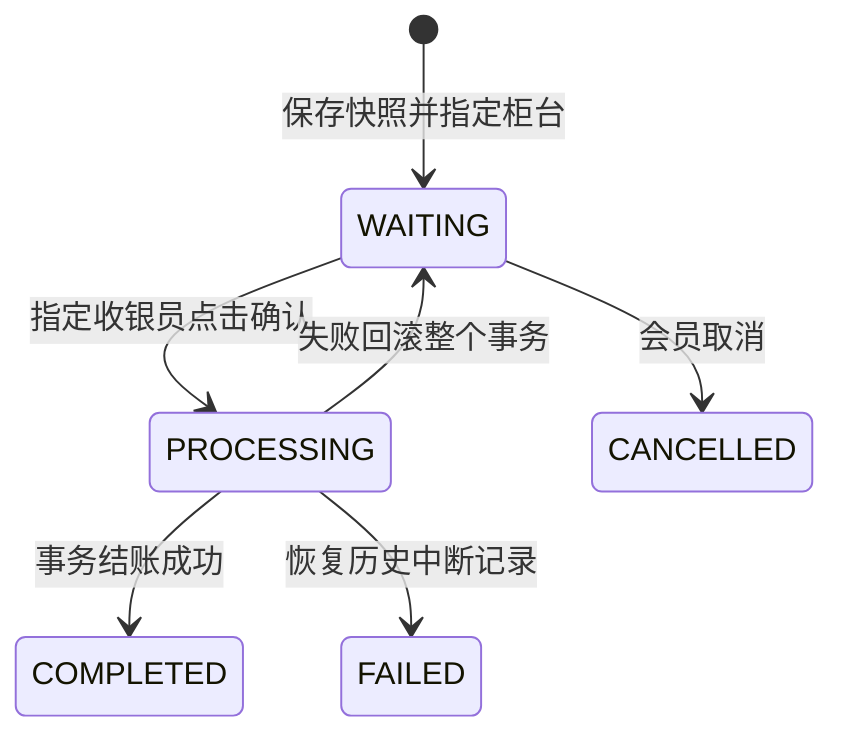

# 需求与业务规则

## 项目目标

为极序数码电子产品门店提供浏览器操作界面，形成“采购入库 → 商品销售 → 库存扣减 → 订单与积分 → 退货 → 统计”的业务闭环，同时能清楚展示 Java 类、接口、多态、异常、集合、文件输出、权限、锁和数据库事务。

本轮业务背景为“极序数码”电子产品零售，展示手机、电脑、智能手表、显卡等设备的选购、采购和售后。老板为乔胤淇，界面称呼乔先生，仍使用 admin 登录。需求、文档和代码一起更新。

## 角色权限

| 功能 | 老板 ADMIN | 销售员 SALES | 会员 MEMBER |
|---|---|---|---|
| 查看商品 | 全部商品 | 全部商品 | 上架商品 |
| 分类、商品资料、上下架 | 可管理 | 只读 | 不可管理 |
| 供应商、采购入库 | 可管理或查看 | 无权限 | 无权限 |
| 库存流水 | 可以查看 | 可以查询，无维护权限 | 无权限 |
| 购物车、个人排队 | 不作为会员操作 | 不作为会员操作 | 仅本人 |
| 员工收银 | 可以 | 可以 | 使用排队结账 |
| 确认会员提交单 | 查看全店，不代确认 | 仅分配给本人 | 不可确认 |
| 查看订单 | 全部 | 仅本人经手 | 仅本人订单 |
| 申请整单退款 | 不代替会员申请 | 只读本人经手订单的申请与结果 | 对本人的有效已支付数码订单申请 |
| 审核退款 | 批准或填写原因拒绝待审核申请 | 不可审核、不可直接退款 | 查看结果，被拒绝后可重新申请 |
| 用户管理、禁用账户 | 可以，不能禁用自己 | 无权限 | 无权限 |
| 积分流水 | 不读取会员隐私页 | 不读取会员隐私页 | 仅本人 |
| 经营统计、日志、导出 | 可以 | 无权限 | 无权限 |
| 优惠规则 | 可查看和修改 | 可查看 | 可查看 |
| 创建收银员、安排柜台、启停收银员 | 可以，收银员总数最多 4 人 | 无权限 | 无权限 |

页面隐藏按钮只是界面表现，真正的权限检查必须在 Java 后端执行。用户即使手工修改网址或 HTTP 请求，也不能读取其他会员订单或冒充销售员。

## 商品与库存

- 商品属于一个分类，SKU 唯一，名称和价格需要校验。商品描述保存型号、内存/容量、屏幕等可读参数；当前没有单独的参数表、序列号或逐台设备保修档案。
- 金额在 Java 中使用 `BigDecimal`，数据库使用 `DECIMAL`。
- 库存不能小于 0；购买、入库数量必须是正整数。
- 新商品可以设置初始库存；创建后增加库存通过采购入库，不能通过普通编辑商品绕过库存流水。
- 下架商品不能被新订单购买；购物车已有下架商品时，结账时也要重新校验。
- 已被订单等数据引用的商品不应直接删除，可改为下架，保留历史订单的可追溯性。
- 订单明细保存下单时的商品名称、单价和数量快照，后来改商品名称或价格不会改变旧订单。

## 优惠与会员等级

会员等级按净累计消费 `total_spent` 计算，退款会回退累计消费：

| 净累计消费 | 等级 | 会员折扣率 |
|---|---|---|
| 小于 5000 元 | 普通会员 | 1.00 |
| 满 5000 元 | 银卡 | 0.98 |
| 满 15000 元 | 金卡 | 0.95 |
| 满 30000 元 | 黑金 | 0.90 |

一笔订单依次计算：

1. 所有商品的单价乘数量求和，得到原价总额。
2. 应用后台设置的普通折扣率，默认 1.00。
3. 如果是会员订单，应用结账前累计消费对应的会员折扣。
4. 折后金额达到满减门槛时减去满减额，默认满 3000 减 100。
5. 每步以分为精度四舍五入，最终金额最低为 0。

例如金卡会员购买原价 4000 元的数码设备，普通折扣为 0.90：普通折后 3600.00 元，会员折后 3420.00 元，满足满 3000 减 100，实付 3320.00 元。本单获得 3320 积分。

折扣 0.90 表示按原价的 90% 收费，即“九折”，不是“减掉 90%”。预览金额只供确认；真正结账时必须从数据库重新读取商品、库存和优惠配置，不能相信浏览器传来的应付金额。

## 订单、积分和退款

- 支付是模拟支付，结账成功创建 `PAID` 订单，不连接银行或支付平台。
- 同一请求通过 `requestKey` 标识，重复点击不能重复扣库存、重复赠送积分。
- 每笔成功会员订单的赠送积分为实付金额向下取整。
- 积分流水记录变化值、变化后的余额和关联订单。
- 当前只支持会员申请整单退款。会员在自己的有效 `PAID` 订单填写原因，申请状态变为 `PENDING`；订单仍保持 `PAID`，库存、消费和积分不变。
- 老板在“退款审核”批准或拒绝；拒绝必须填写原因，会员和原收银员可查看。拒绝后为 `REJECTED`，仍不改变库存与积分，会员可以补充原因重新申请。
- 只有老板批准待审核申请，才将申请置为 `APPROVED`、订单由 `PAID` 变为 `REFUNDED`。收银员只能查看，老板也不能绕过会员申请直接退款。
- 旧版直接退款入口禁止执行；会员不能替其他会员申请，也不能审核自己的申请。未绑定会员的散客订单不在本轮会员自助申请范围内。
- 退款恢复本单商品数量，扣回本单当时实际赠送的积分，回退净累计消费。
- 退款使用订单中记录的金额与积分，不按退款时的新折扣重新计算历史订单。
- 同一订单只能成功退款一次；重复提交待审核申请被拒绝。批准与拒绝并发时只有一个决定能成功，审批和退款写入失败则回滚。

支付事务内需要同时完成：检查库存、减少库存、写订单、写明细、写库存流水、更新会员消费与积分、写积分流水。任何一步失败都要回滚。

## 采购

老板选择数码设备或电脑配件供应商与商品，填写入库数量和采购单价。入库时创建采购单和明细、增加商品库存、写库存流水。这些步骤在同一事务中完成。

采购单价用于采购成本记录，不自动替换商品零售价。本轮销售统计主要展示销售金额和销量，不宣称已经实现会计意义上的完整毛利核算。

## 排队与柜台

会员提交时，服务端保存购物车中商品编号和数量的快照，并马上分配一个明确的收银台及收银员。默认 1 号台为小周（cashier1），2 号台为小陈（cashier2）；会员页面显示同一份柜台信息、等待状态与排队位置。

只有票据指定的启用销售员可以在收银工作台核对商品并点击确认结账；同一柜台按提交顺序办理，先确认排在第一位的票据。等待期间不会扣库存、清空购物车、生成支付订单或增加积分；会员可以取消。购物车快照不会因为后续购物车改动而变化，库存与金额在收银员真正确认时重新验证，提交不代表预留库存或锁定价格。

票据状态：



柜台和员工的绑定保存在 `checkout_counter`，不会因为某个员工停用而把其他员工的编号挤到前面。新提交在已开放且绑定启用员工的柜台中，优先分配等待人数较少的柜台，人数相同按柜台编号。`COUNTER_COUNT` 限制接收新单的范围；缩减柜台后，原启用员工仍可处理已分配的等待单。账号停用时柜台不再接新单；有待确认票据的员工不能停用或调岗，先由该员工完成或由会员取消提交。

正常等待票据保存在数据库，应用重启后继续等待人工确认。启动时先根据 `queue:票据编号` 恢复已经成交的遗留票据；历史处理中断或缺少柜台归属的旧票据明确结束，防止状态含糊。收银员确认将认领、订单、库存、积分、购物车变化与票据完成放在同一事务中；重复确认返回同一订单，取消与确认不能同时生效。会员仅查看本人票据，销售员仅查看分配给自己的票据，老板可查看全部。

## 收银员管理

老板在“收银员管理”创建账号，填写用户名、姓名、初始密码及空闲收银台。用户名使用 3 至 30 位字母、数字或下划线；密码为 8 至 60 个字符且 UTF-8 长度不超过 72 字节。角色由服务端固定为 SALES，密码经 BCrypt 哈希保存，接口不返回密码或哈希。公开注册入口仅用于会员。

收银员账号总数最多 4 个，含停用账号；默认两名收银员占两个名额。新增账号同时绑定柜台，必要时提高开放柜台数量，使新员工可立即接收排队提交。管理员可把员工调到未占用的柜台，也可以启用或停用账号。调岗涉及的柜台或该员工有 WAITING/PROCESSING 票据时拒绝操作，不能把等待顾客留给无人负责的柜台。停用不会删除历史订单或释放账号名额。

## 并发一致性与统计口径

后台的限量抢购实验页面及接口已移除。真实订单仍需要应对多个顾客同时购买：自动化测试在隔离数据上构造并发请求，检查库存、订单和积分的一致性。

关键不变量为：

```text
剩余库存 >= 0
本次成功卖出数量 + 剩余库存 = 初始库存（测试期间没有其他库存变动）
库存不足的请求不产生已支付订单与赠送积分
```

为兼容此前实验遗留数据，经营统计、日常订单列表和 CSV 导出仍排除 `demo:` 前缀的实验订单，商品与会员列表同样隐藏专用实验记录。`DEMO-` 商品编码和 `demo_` 用户名前缀由系统保留，日常收银不得使用实验商品或实验会员。

统计按有效已支付订单计算，已退款订单不计入净销售额；按原支付日期分组的趋势图也移除这笔已退款订单。热销榜按有效订单的商品数量排名，旁边金额是商品原价小计，未把整单优惠分摊到商品。销售员业绩按实际应付金额统计。已支付订单数表示当前已支付且未退款的订单数。

## 非功能要求

- 可读性：方法有中文说明，控制器、业务、SQL 分层，尽量用显式普通 Java 代码。
- 一致性：事务保护订单、库存和积分，固定锁顺序降低死锁风险。
- 安全：BCrypt 哈希、Session 登录、CSRF、服务端权限、参数化 SQL，不返回密码哈希。
- 可恢复性：失败消息清楚，队列重启有明确处理规则。
- 可演示性：预置三类账号、商品和库存，重要操作可在界面完成。
- 可测试性：自动化测试与真实 MySQL 验证分开记录。


## 改版前演示订单的边界

V2演示背景迁移复用了旧种子商品编号。SKU快照为空且名称精确匹配旧版12个种子商品的订单，标记为早期演示订单，只读保留原名称、金额、状态。它们不支持整单退款，防止旧食品/日用品退回现在的数码库存。已有SKU快照的新订单以及普通数码商品改名、调价不受此限制。该规则是本次课程演示数据的兼容处理，不是所有历史订单都不可退款。历史销量仍含这些记录，并按成交名称展示。
