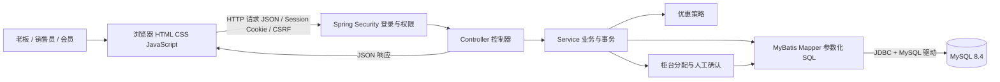
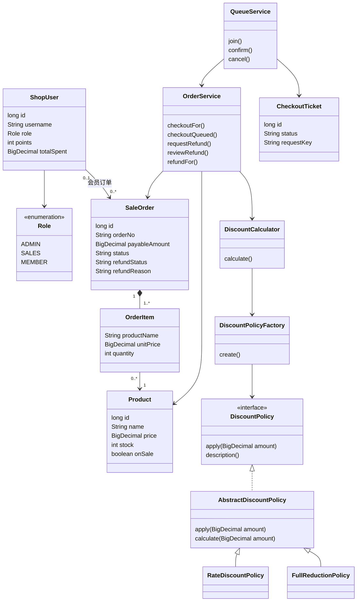
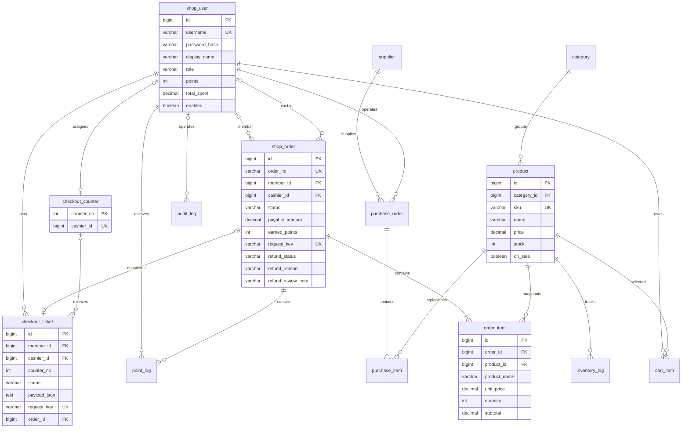
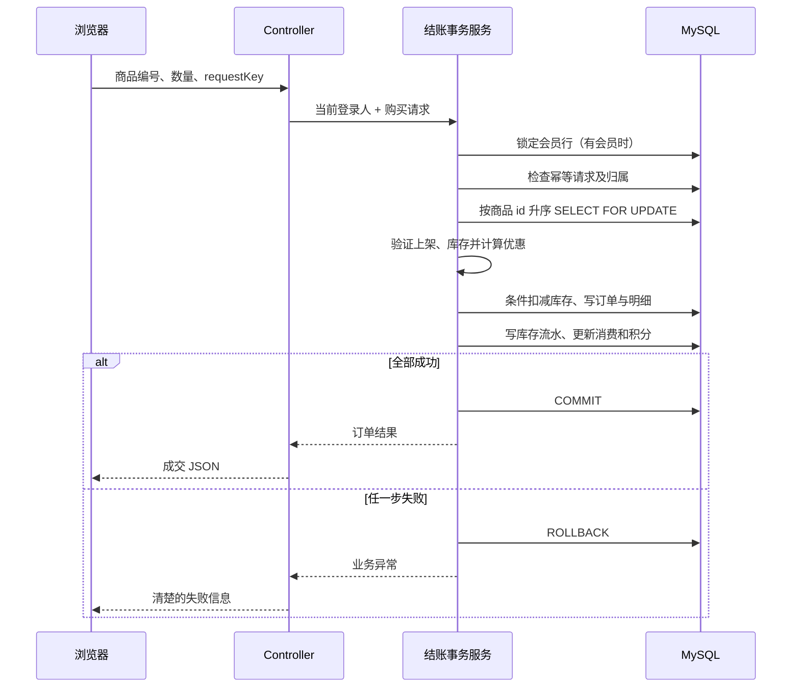
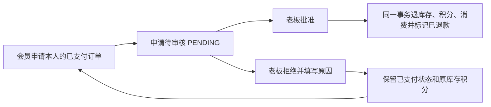

# 架构、类图与数据库设计

## 运行时整体结构

浏览器负责显示页面和收集用户操作；Java 负责校验、权限、计算、事务和调用数据库；MySQL 负责持久保存数据。前端不能直接连接 MySQL，也不能决定最终成交金额。

这是一个分层单体应用：所有 Java 模块打成一个 jar、使用一个数据库，只有一次 Java 启动。分层使职责清楚，不代表需要启动多台服务器。

## 模块职责

| 包或目录 | 职责 | 适合优先阅读的内容 |
|---|---|---|
| `common` | 统一响应、业务异常、全局错误处理 | 普通类、泛型、异常 |
| `security` | Session 中的当前用户、认证与访问控制 | 一次请求如何找到当前用户 |
| `user` | 用户、角色、登录、注册、会员公开信息 | 枚举、密码哈希与数据库查询 |
| `catalog` | 分类、商品与上下架 | Controller → Service → Mapper |
| `admin` | 收银员账号与柜台安排、供应商、采购、统计、配置与日志 | 多表事务、聚合 SQL、CSV |
| `order` | 购物车、订单、收银、退款与积分流水 | 金额、事务、锁顺序、幂等 |
| `discount` | 可组合的优惠计算 | 接口、抽象类、继承、多态 |
| `queue` | 固定柜台、等待票据、人工确认 | 状态、权限、事务与数据库锁 |
| `resources/static` | 浏览器页面和样式 | 点击按钮到 fetch 调后端 |
| `resources/db/migration` | 数据库结构版本 | 表、约束、索引与迁移 |

## 概念类图

下图围绕源码中的主要类型展示关系；省略字段和参数，完整方法签名以 Java 文件为准。

同一个 `shop_user` 表保存不同角色。网站角色通过 `Role` 区分，不要求为了展示继承就把三个角色拆成没有不同业务行为的子类。继承与多态主要放在确有变化的优惠策略中。

## 主要数据库关系

关系图用于阅读，完整字段、外键和索引以迁移 SQL 为准。订单明细保留商品快照，不能每次展示历史订单都按商品当前价格重新计算。

## 表说明

| 表 | 内容 | 关键约束或用途 |
|---|---|---|
| `shop_user` | 账号、角色、积分、净消费 | 用户名唯一，不对外返回密码哈希 |
| `category` | 商品分类 | 分类名称唯一 |
| `product` | 商品资料、价格、库存、上下架 | SKU 唯一；库存非负 |
| `supplier` | 供应商资料 | 采购来源 |
| `purchase_order` / `purchase_item` | 采购单与采购明细 | 保存成本、数量和操作人 |
| `inventory_log` | 每次库存变化 | 变化量、变化后数量、关联单号 |
| `cart_item` | 会员购物车 | 会员与商品组合唯一 |
| `shop_order` / `order_item` | 订单、当前退款申请与审核结果、成交快照 | 请求键与单号唯一；退款申请状态独立于支付状态 |
| `point_log` | 会员积分变化 | 订单关联、变化后余额 |
| `checkout_ticket` | 排队状态与购物车快照 | 请求键唯一、可恢复 |
| `checkout_counter` | 固定柜台编号与销售员绑定 | 柜台编号主键，销售员唯一，允许未分配 |
| `shop_setting` | 折扣、满减、柜台数量 | 设置键唯一 |
| `audit_log` | 业务操作记录 | 保留操作人与动作，不记录密码 |

## 结账事务与锁

Java 的 `ReentrantLock` 只协调当前 Java 进程里的线程，不能代替数据库行锁。若两条独立数据库连接都要买最后一件商品，最终必须由 MySQL 事务决定谁成功。

`@Transactional` 依赖 Spring 代理。一个对象在自己内部直接调用自己的事务方法，通常不会经过代理。本项目使用 `TransactionTemplate` 明确事务边界；会员等待单由指定销售员的确认请求触发，柜台认领、支付和完成状态在同一事务中。收银员创建、调岗、启停也在事务内完成，并先按编号锁定柜台，防止与会员提交争用时破坏分配关系。

## 退款申请与审核

V5 为 `shop_order` 增加 `refund_status`、`refund_reason`、`refund_review_note`、`refund_requested_at`、`refund_reviewed_at`。订单保持原支付状态，旧数据默认没有新申请；不会把旧退款补写成一次未经发生的会员申请。当前订单保存最新一次申请，历史动作另记操作日志。

申请与拒绝只更新申请字段；批准进入原退款事务，并再次检查待审核状态和老板权限。会员、商品、订单按统一顺序加锁，审批结果与退款业务数据一同提交或回滚。收银员的订单查询维持本人经手范围，能查看申请原因与处理说明。

## 数据库迁移与故障处理

- 迁移文件记录表结构版本，便于在另一台电脑重建同样结构。
- 库存不足是可预期业务失败，返回中文原因，不创建部分完成订单。
- 人工确认失败回滚事务并向页面返回原因，等待单可重试或由会员取消。
- 正常 WAITING 票据在重启后保留；旧版 PROCESSING 或缺少柜台归属的遗留票据有明确恢复处理。
- 收银员最多 4 人；创建和状态变更在柜台锁内检查约束，有待办时拒绝停用或调岗。
- 日志和 CSV 需要避免保存密码与数据库连接凭据。

## 数码店背景升级

业务模型仍以商品SKU为库存单位，型号、内存、容量等参数放在description，不新增每台设备序列号表。V1建表脚本保持不变，V2追加迁移旧演示分类、商品资料、供应商和默认优惠。商品主键不变，已有订单明细仍使用原下单快照，历史记录可以出现改版前名称；这有助于说明商品当前资料和成交快照的区别。

退款审核列表：`GET /api/refunds` 只允许 ADMIN，独立查询全部退款申请，待审核优先，不受普通订单最近 500 条上限影响。
