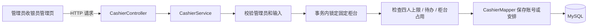

# 收银员管理与排队精简

本次需求由使用者在实际查看系统后提出：管理员需要能创建和安排其他收银员，最多四人；“限量设备抢购·并发实验”与数码门店日常操作关系不大，因此移除。

本文件记录功能与验收方法。测试是否通过，以随后实际执行的验证记录为准；不把此前的 119 项测试结果当作本次新增功能的结果。

## 管理员如何使用

1. 在 IDEA 停止旧应用并重新运行。登录 `admin`，刷新浏览器后打开左侧“收银员管理”。
2. 查看现有员工和柜台。默认 `cashier1`、`cashier2` 已占两个名额，还可以创建两名收银员。
3. 点击新增按钮，填写账号、姓名、初始密码，选择未被占用的柜台。例如为第 3 位员工选择 3 号台。密码由你自己设置，不把实际密码写入报告或截图。
4. 创建成功后，用另一个独立浏览器会话登录新账号。该账号的角色固定为 SALES，可以使用收银工作台。
5. 会员提交时会在可接单柜台中选择当前等待人数最少的一台；人数相同时优先较小编号。因此新员工不会收到每一笔提交，须以会员页面的实际分配结果为准。
6. 调整员工柜台时选择空闲台；有待确认票据时，先由原员工办理，或由会员取消。停用员工也遵循这项规则。

新建账号、调岗或再次启用员工时，会根据需要提高开放柜台数量，使安排的柜台能够接单。管理员仍可在“优惠与设置”调整开放柜台数量；缩减后只停止新提交，已经分配的票据仍由原启用员工处理。

## 本次确认的规则

| 问题 | 当前规则 |
|---|---|
| 谁能创建收银员 | 只有管理员；公开注册页仍只创建会员 |
| 最多四人如何计算 | 全部 SALES 账号，包括启用和停用的账号；原有两人也计入 |
| 一个员工可安排几个柜台 | 一个；一个柜台也只能安排一名员工 |
| 可以安排到哪些柜台 | 1 至 4 号中的空闲柜台 |
| 员工仍有等待顾客时能调岗吗 | 不能；先完成或取消相关票据 |
| 停用是否删除员工和旧订单 | 不删除，旧订单继续保留原经手员工 |
| 停用是否腾出新账号名额 | 不腾出；再次启用原账号即可恢复使用 |
| 密码如何处理 | BCrypt 哈希保存，列表和其他响应不返回密码或哈希 |
| 登录页新增了公开收银员注册吗 | 没有；由管理员创建，以符合门店人员管理职责 |

当前不提供员工删除、批量换班、员工资料修改或密码重置。四人限制是本课程版本的需求，不代表一般零售系统都应限制四人。

## 接口与代码

| 操作 | 接口 | 主要输入 |
|---|---|---|
| 查看员工与柜台 | `GET /api/cashiers` | 无 |
| 创建收银员 | `POST /api/cashiers` | `username`、`password`、`displayName`、`counterNo` |
| 调整柜台 | `PUT /api/cashiers/{id}/counter` | `counterNo` |
| 启用或停用 | `PATCH /api/cashiers/{id}/enabled` | `enabled` |

这些接口都要求管理员身份，写请求还需要 CSRF token。原有 `PATCH /api/users/{id}/enabled` 对收银员也使用相同的待办保护，不能绕过新页面直接停用正在接待顾客的员工。

人数上限不能只靠按钮变灰。如果目前已有三名员工，两个创建请求同时到达，必须让它们按顺序检查并保存，否则可能同时各自认为还有一个空位。这里使用数据库事务和固定柜台行锁协调，会员提交使用相同方向的柜台锁，避免刚分配顾客时又把员工换走。

## 现在的排队页面

“排队与并发”改名为“排队管理”，只展示柜台、员工和真实会员提交。人工抢购实验的表单、结果展示和 `/api/queue/demo` 入口已经移除。

库存不超卖、订单不重复、退款不多还库存仍是必要规则，继续由真实业务逻辑和隔离环境中的自动化测试验证。旧版本实验留下的数据过滤仍保留，避免旧实验订单进入日常经营统计；本次不会为了删页面去清空已有数据库。

## 你亲自验收时填写

先保存操作前的员工数和柜台分配，按实际需要创建员工，不必为测试把自己的日常库塞满四个永久账号。人数上限与并发争抢名额可由隔离测试完成，你复核测试条件和结果。

| 场景 | 预期 | 我的实际结果 |
|---|---|---|
| 管理员查看收银员管理 | 看到现有员工、名额和柜台 | 待填写 |
| 新增一名员工并安排空闲台 | 员工和柜台同时保存，列表不展示密码 | 待填写 |
| 新账号登录 | 显示销售员菜单，可进入收银工作台 | 待填写 |
| 会员提交给新员工并确认 | 只有该员工可确认，成交后库存积分正确 | 待填写 |
| 员工有待办时停用或调岗 | 明确拒绝，原分配不变 | 待填写 |
| 无待办时调整至空闲台 | 安排持久保存，会员看板读取相同信息 | 待填写 |
| 查看排队管理 | 没有抢购实验，原排队功能可用 | 待填写 |
| 复核自动化四人上限验证 | 顺序和并发创建均不超过四人，停用仍计数 | 待填写 |

本次也可以作为 AI 协同开发案例：你发现管理入口缺失、提出人数上限并决定精简不必要功能；AI 协助分析依赖、实现和自动化验证；你负责确认规则并亲自检查页面与主流程。
